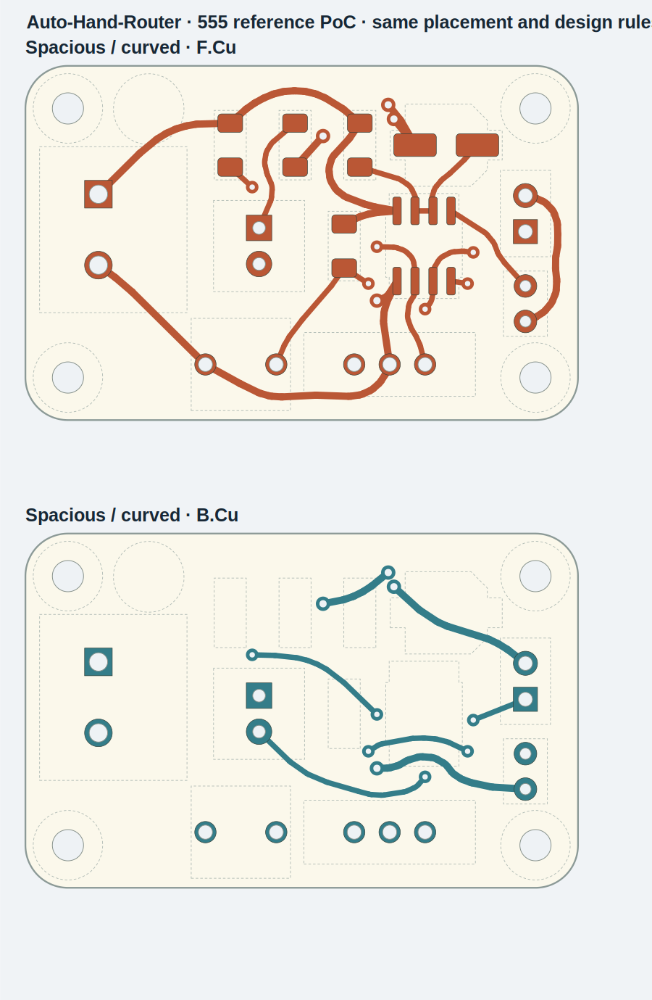
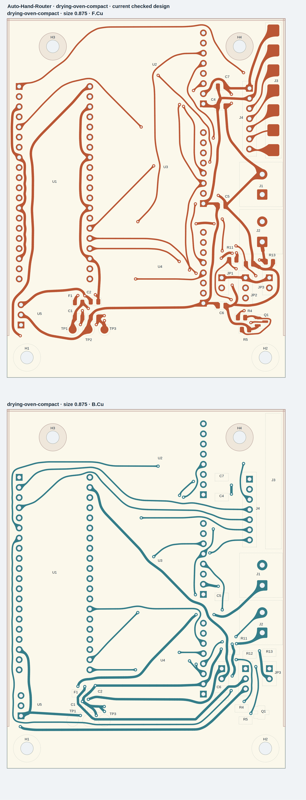
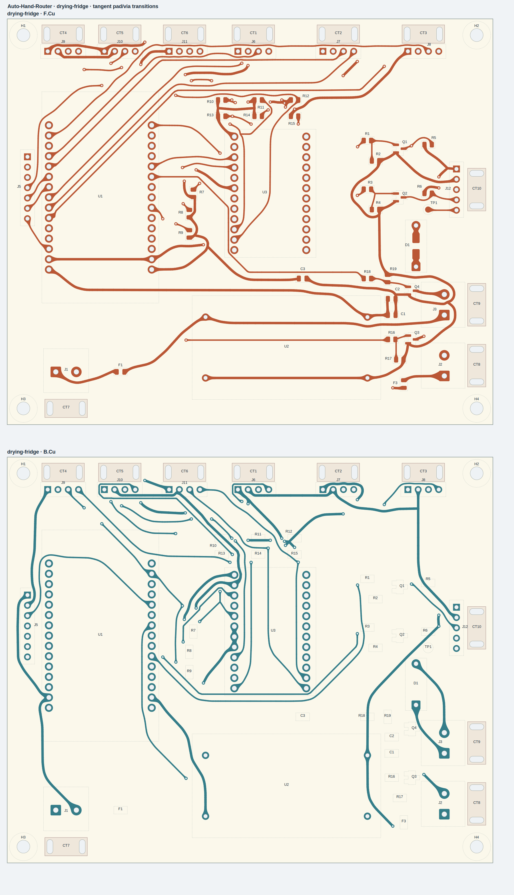
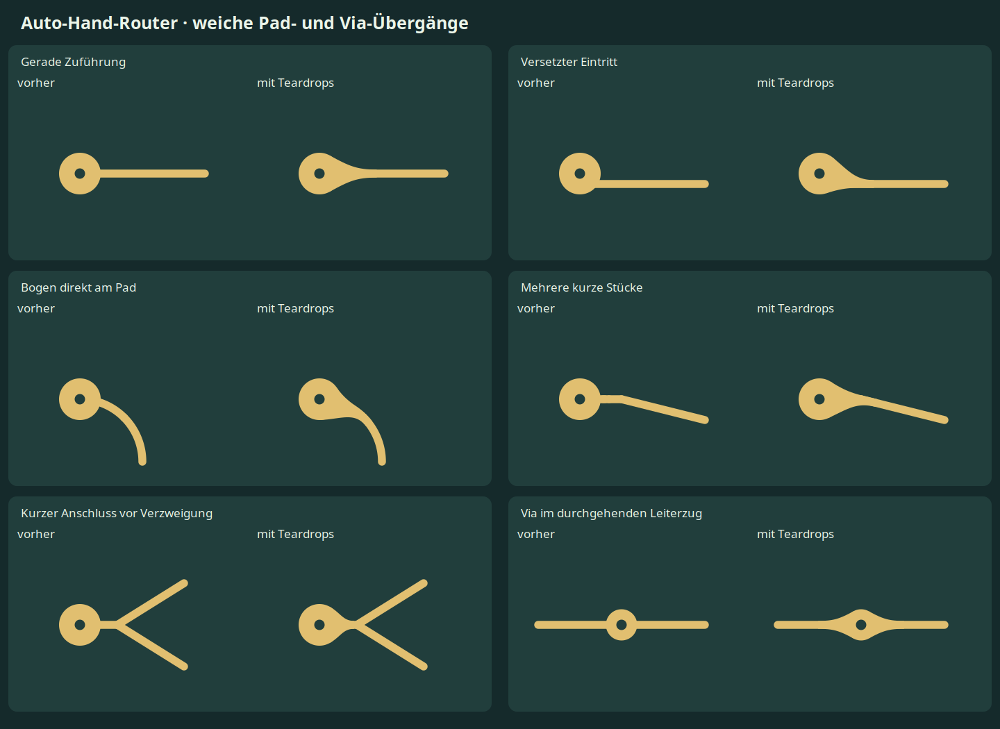

# Auto-Hand-Router

Curved tracks and teardrops for two-layer KiCad 10 boards.

Freerouting or J-Kreisel handles the connections. Auto-Hand-Router spreads and
smooths the tracks, adds teardrops and checks the result.

## Demos

### 555 timer

Eight nets, 291 native arcs and ten vias. Uses the built-in reference router.



[KiCad project](examples/555-reference/routed.kicad_pro) ·
[Board source and license](examples/555-reference/SOURCE-LICENSE.txt)

### Drying Oven Compact

70 × 90 mm, 2,287 arcs, 43 vias and 229 teardrop shoulders.
No ERC, DRC or schematic parity findings.



[KiCad project](examples/drying-oven-compact/drying-oven-compact.kicad_pro) ·
[Results](examples/drying-oven-compact/summary.json)

### Drying Fridge

120 × 100 mm, 2,568 arcs, 45 vias and 274 teardrop shoulders.
All connections closed. Existing library and metadata warnings are listed in the results.



[KiCad project](examples/drying-fridge/drying-fridge.kicad_pro) ·
[Results](examples/drying-fridge/summary.json)

### Pad and via transitions

Teardrops follow straight tracks and native arcs, including offset entries and
short connected pieces. Default size: 0.875.



## Setup

Linux, Python 3.12+, [uv](https://docs.astral.sh/uv/) and KiCad 10 with its
`pcbnew` Python module. Components must be on the front side.

```sh
git clone https://github.com/ckbaker10/auto-hand-router.git
cd auto-hand-router
uv sync --locked

kicad-cli version
/usr/bin/python3 -c 'import pcbnew; print(pcbnew.Version())'
```

If KiCad uses a different interpreter or is outside your PATH:

```sh
export AUTO_HAND_ROUTER_KICAD_CLI=/path/to/kicad-cli
export AUTO_HAND_ROUTER_KICAD_PYTHON=/path/to/python3
```

For the `route` command, choose one backend.

### Freerouting

Requires Java 25. Download the pinned 2.5.0 JAR:

```sh
mkdir -p "$HOME/.local/share/auto-hand-router"
curl -fL https://github.com/freerouting/freerouting/releases/download/v2.5.0/freerouting-2.5.0.jar \
  -o "$HOME/.local/share/auto-hand-router/freerouting-2.5.0.jar"

export AUTO_HAND_ROUTER_FREEROUTING_JAR="$HOME/.local/share/auto-hand-router/freerouting-2.5.0.jar"
```

The router checks the JAR checksum.

### J-Kreisel

```sh
uv sync --locked --extra kreisel
```

A Rust toolchain may be needed to build it. Use
`uv run --locked --extra kreisel auto-hand-router route --backend kreisel`
with the board, output and work options below.

## Route a board

Keep the PCB, project and schematic together with the same filename stem:
`controller.kicad_pcb`, `controller.kicad_pro`, `controller.kicad_sch`.
Existing project rules and library tables are used.

```sh
uv run --locked auto-hand-router route \
  --board /path/to/controller.kicad_pcb \
  --output-dir output/controller \
  --work-dir work/controller-001 \
  --spacing 1.2 \
  --teardrop-size 0.875
```

This uses Freerouting. The source project stays unchanged.
The output contains the KiCad project, SVG/PNG previews and `report.json`.
Use a new work directory for each run.

| Option | Effect |
| --- | --- |
| `--spacing 1.2` | Preferred extra clearance in mm. Minimum project clearances still apply. |
| `--via-policy courtyards` | Default. Keeps vias outside component courtyards. |
| `--via-policy module-interiors` | Allows vias under large through-hole modules. Pad, drill and keepout clearances still apply. |
| `--radius 2.5` | Maximum radius for local fallback fillets, in mm. |
| `--teardrop-size 0.875` | Scales teardrop length and shoulders. |
| `--no-teardrops` | Disables teardrops. |

Project netclasses are used by default. Add
`--profile profiles/jlcpcb-2layer-1oz.json` to apply the included profile.
For this profile, put your power nets in `kicad-workflow.json` next to the board:

```json
{"routing": {"power_net_patterns": ["/+5V", "/+3V3", "/GND"]}}
```

## Add teardrops to an existing board

```sh
uv run --locked auto-hand-router teardrops \
  --board /path/to/controller.kicad_pcb \
  --output-dir output/controller-teardrops \
  --work-dir work/controller-teardrops-001 \
  --size 0.875
```

This keeps the existing tracks and adds copper zones at pads and vias.
Both directories must be new. Use `--length-ratio` and `--max-length` to
adjust the shape. Add `--via-policy module-interiors` if the board already
uses vias under modules.

## Reproduce the demos

The routed projects shown above are included in `examples/`.

Generate the 555 routing and then add teardrops. No external routing backend is needed:

```sh
uv run --locked auto-hand-router --comparison --output-dir output/555

uv run --locked auto-hand-router teardrops \
  --board output/555/routed.kicad_pcb \
  --output-dir output/555-teardrops \
  --work-dir work/555-teardrops-001
```

Rebuild teardrops and previews for the two larger demos:

```sh
uv run --locked auto-hand-router teardrops \
  --board examples/drying-oven-compact/drying-oven-compact.kicad_pcb \
  --output-dir output/oven-teardrops \
  --work-dir work/oven-teardrops-001 \
  --via-policy module-interiors

uv run --locked auto-hand-router teardrops \
  --board examples/drying-fridge/drying-fridge.kicad_pcb \
  --output-dir output/fridge-teardrops \
  --work-dir work/fridge-teardrops-001
```

To reroute either project, use its PCB with the `route` command.
The Compact uses J-Kreisel; the Fridge uses Freerouting.

Run the checks and build the package:

```sh
uv run --locked pytest -q
uv run --locked ruff check auto_hand_router comparison tests tools/sync_project_examples.py
uv build
```
