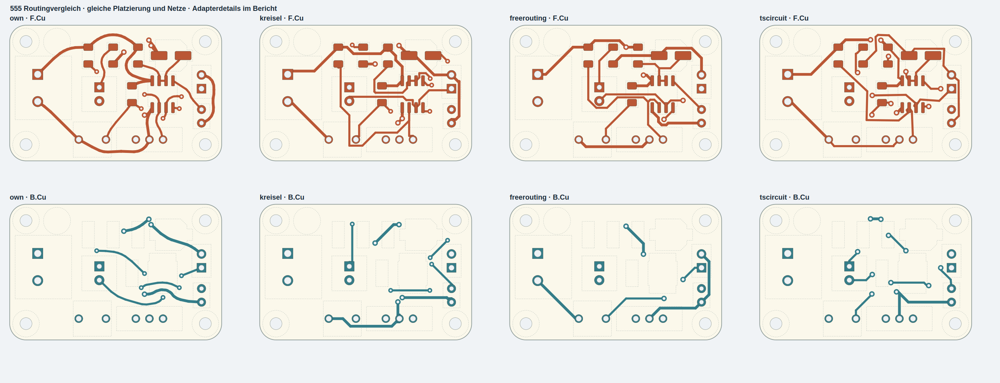
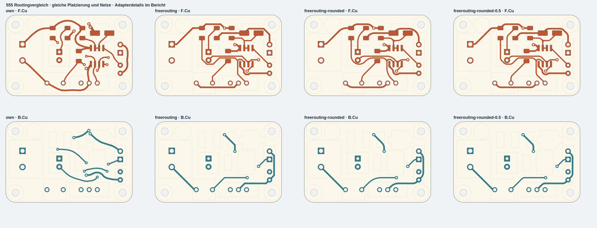

# Router comparison on the 555 board

Same placement and netlist, two copper layers, eight nets and 22 initially
open connections. These are measured results on one board, not a general
ranking of the routing engines.

| Router | Open | Vias | Copper length | Native arcs | New KiCad findings |
|---|---:|---:|---:|---:|---:|
| Auto-Hand-Router Spacious / curved reference | 0 | 10 | 210.52 mm | 133 | 0 |
| J-Kreisel core with body keepouts | 0 | 10 | 236.13 mm | 0 | 0 |
| Freerouting 2.5.0 with conservative rule adapter | 0 | 4 | 217.52 mm | 0 | 0 |
| Freerouting + mitxela rounding, 2 mm | 0 | 4 | 216.02 mm | 55 | 4 clearance errors |
| Freerouting + mitxela rounding, 0.5 mm | 0 | 4 | 217.71 mm | 53 | 3 clearance errors |
| tscircuit Pipeline9 | 0 | 11 | 215.61 mm | 0 | 0 |

The first three rows also pass the reference's independent geometry and
strict footprint-body via checks. Eight tscircuit vias violate that additional
body policy; some output segments differ from requested class widths. Its
three sub-micrometre conservative distance findings are within the independent
checker's approximation margin, not confirmed KiCad clearance errors.

Freerouting uses enlarged via-only body obstacles and the larger permitted
via type; automatic neckdown is disabled. J-Kreisel uses conservatively
bounded rectangular pads and buffered body keepouts. tscircuit uses an SRJ
adapter with global maximum clearances, per-connection nominal widths and
deduplicated physical vias. These adapter differences matter when interpreting
the results.

Topola builds and processes its supplied small 0603 example. On the common
555 input, the default CLI and multilayer command produced no SES file within
180 and 120 seconds respectively. No route-quality values are invented for
those attempts.

The comparison supports keeping the spacious reference for style while using
Freerouting as an electrical routing baseline. It does not claim our reference
has optimal length, layer assignment or via count.

[Measured geometry and DRC summaries](results/results.json) ·
[Source revisions and licenses](source-revisions.json)

`prepare.py`, `kicad_exchange.py`, `kreisel.py`, `tscircuit.mjs`,
`dsn_keepouts.py`, `round_tracks.py` and `evaluate.py` contain the adapters.
Raw external checkouts, binaries, downloaded photos and runtime logs are not
part of this repository. The generated figures use the MIT-licensed 555 input;
its original license is included with the examples and comparison outputs.
