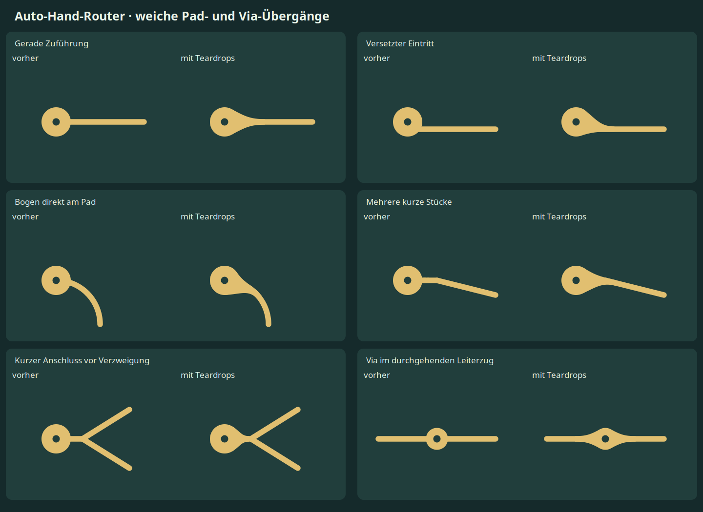

# Melting KiCad: Analyse und uebernommene Teardrops

Stand: 01.11.2026. Ausgangsstand unseres Routers: `a46a9e8`.

Die wichtigste Ergaenzung sind **weiche Kupferschultern an Pads und Vias**.
Die Verarbeitung der vorhandenen Kurven bleibt erhalten. Die neue Stufe folgt
den fertigen Leiterzuegen und fuegt anschliessend gepruefte Kupferzonen hinzu.
Auf Nutzerwunsch ist die Standardgroesse `0.875`: Laengsausdehnung und
Schulteransatz werden um 12,5 % reduziert. Die Kontaktpunkte werden auf der
Padkontur neu berechnet, damit die Tangenten beim Verkleinern erhalten bleiben.



## Quellen und alle Beispielbilder

Untersucht wurden [Teil 1 vom 09.01.2021](https://mitxela.com/projects/melting_kicad),
[Teil 2 vom 30.01.2022](https://mitxela.com/projects/melting_kicad_2) und der
[Plugin-Quellstand 50374f8f418e57b53683dd18171bb9cf1f9392f8](https://github.com/mitxela/kicad-round-tracks/tree/50374f8f418e57b53683dd18171bb9cf1f9392f8).
Beide Artikel wurden vollstaendig einbezogen, einschliesslich **aller 41
Illustrationen**, nicht nur der Platinen-Gesamtansichten.

Die [vollstaendige Bildgalerie](melting-kicad-gallery.html) bietet Originalgroessen
und Quellenlinks. Fremdbilder werden dort von mitxelas Website geladen; die
lokalen Analysesnapshots bleiben im ignorierten `work/`. Die Apache-Lizenz des
Plugins wird nicht pauschal auf die Artikelbilder oder historischen Fotos angewandt.

| Bilder der Galerie | Bedeutung fuer unseren Router |
| --- | --- |
| 1–4: historische Platinen | Referenz fuer zusammenhaengende Kupferformen und ruhige Bahnverlaeufe. |
| 5: Gesamtvergleich | Bahnfuehrung und Kontaktverbreiterung als getrennte Bearbeitungsschritte betrachten. |
| 6–7: ungleiche Verrundungen | Reihenfolge- und Richtungsabhaengigkeit gezielt testen. |
| 8–11: Unterteilung und Eckschritte | Ausgangsgeometrie pro Bearbeitungsschritt unveraendert auswerten. |
| 12: parallele Bahnen | Gleichmaessige Abstaende auch in Boegen als eigenes Qualitaetsziel messen. |
| 13–14: Quadrat und freie Winkel | Enge Doppelkurven sowie spitze und flache Winkel als Grenzfaelle behandeln. |
| 15: fehlerhafter versetzter Anschluss | Flanken nicht aus einer angenommenen radialen Zufuehrung ableiten. |
| 16: Bezier-Kontrollpunkte | Tangenten an Kontaktkontur und Leiterbahnkante vorgeben. |
| 17: versetzte Anschluesse | Linke und rechte Flanke getrennt gewichten. |
| 18: gedrehte Anbindung | Kontaktpunkte auf der tatsaechlichen Kontur waehlen. |
| 19: kurze/schiefe Anschluesse | Laenge begrenzen und bei Platzmangel kleinere Formen erzeugen. |
| 20: winzige Teardrops | Nicht die erste Segmentlaenge als gesamte verfuegbare Laenge verwenden. |
| 21–22: Verfolgen der Zufuehrung | Ueber mehrere Stuecke hinweg bis zur geeigneten Anschlussstelle gehen. |
| 23: verschiedene Teardrop-Groessen | Formgroesse als Verhaeltnis zur Kontaktgroesse und mit absolutem Limit steuern. |
| 24: nahe Verzweigung | Am Knoten stoppen; keine willkuerliche Astwahl. |
| 25: Kontakt mitten im Leiterzug | Fuer beide Richtungen eine Schulter bilden. |
| 26–28: komplette Ergebnisse | Nicht nur Detailkonturen, auch die Gesamtwirkung kontrollieren. |
| 29–31: Fillet-Grenzen | Zu kurze und direkt aufeinanderfolgende Ecken gemeinsam pruefen. |
| 32–35: Winkel und Radiuskorrektur | Eine Stilvorgabe benoetigt eine klare, winkelabhaengige Bedeutung. |
| 36–37: native Boegen | Vorhandenen nativen Bogenexport beibehalten. |
| 38–39: T/Y/X-Verzweigungen | Topologie erhalten; Mehrfachknoten separat von normalen Kurven behandeln. |
| 40–41: Boegen an Kontakten | Bogenlaenge und lokale Tangente fuer den Teardrop-Anschluss verwenden. |

Die Einzelbilder sind in der Galerie direkt mit ihren Originaldateien verknuepft.

## Was die Artikel und der Plugin-Code beitragen

Teil 1 zeigt zwei wichtige Fehlerklassen: veraenderte Segmentlaengen waehrend
eines Verrundungsdurchlaufs und Teardrops, die eine versetzte oder unterteilte
Zufuehrung falsch interpretieren. Als Gegenmittel beschreibt mitxela gespeicherte
Ausgangslaengen, tangentiale kubische Bezier-Flanken und das Verfolgen verbundener
Leiterstuecke. An Verzweigungen endet dieses Verfolgen. Seine Aussage zur
DRC-Sicherheit von Zonen wird im Artikel selbst fuer ueberlappende Teardrops
eingeschraenkt. Diese sind daher kein Ersatz fuer eine abschliessende Pruefung.
[Quelle: Teil 1](https://mitxela.com/projects/melting_kicad).

Teil 2 ergaenzt native Kreisbogen-Ausgabe und den Umgang mit kurzen Stuecken,
Winkelkorrekturen und Bogen-Zufuehrungen. Seine zentrale Folgerung fuer Teardrops:
Position und Tangente muessen entlang des Bogens bestimmt werden.
[Quelle: Teil 2](https://mitxela.com/projects/melting_kicad_2).

Im untersuchten `round_tracks_action.py` liegt die Kernlogik in Zeilen 334–540:
Ausgangslaengen werden zwischengespeichert, angeschlossene Tracks nach Winkel
geordnet, native Boegen aus Start/Mitte/Ende erzeugt und neue Objekte gesammelt
eingefuegt. Eine vollstaendige geometrische Abstandspruefung ersetzt dieser
Algorithmus nicht. Der Code ist daher eine Geometriereferenz fuer uns;
die neue Teardrop-Implementierung wurde unabhaengig geschrieben.
[Gepinnter Quellcode](https://github.com/mitxela/kicad-round-tracks/blob/50374f8f418e57b53683dd18171bb9cf1f9392f8/round_tracks_action.py#L334).

## Abgleich mit unserer bisherigen Implementierung

`curves.py` erzeugt bereits eine C2-Spline-Zielkurve und approximiert diese durch
tangentiale native Biarcs. Die exportierten Kreisboegen sind dabei nicht generell
G2-stetig. `router.py:fillet` liest unveraenderte Eingabesegmente und prueft
Abstaende. Ein Wechsel auf wiederholte Unterteilung waere fuer uns kein Fortschritt.

Zwei andere Punkte bleiben eigenstaendige Verbesserungen:

- **Radiussteuerung:** In `smooth_path` sind die Spline-Pitches fest vorgegeben.
  `radius` wirkt nur im Fillet-Fallback. Ein freier L-Pfad ergibt bei 0,1 und
  3,0 mm jeweils dieselben 20 Primitive und Hausdorff-Abstand 0. Dieser Befund
  ist reproduziert; die Radiussteuerung wurde in dieser Teardrop-Aenderung
  nicht umgebaut.
- **Gemeinsames Formen benachbarter Bahnen:** `finish` bearbeitet Netze nach ID
  und ersetzt sie nacheinander in der Szene. Ein geometrisch abhaengiger oder
  gemeinsamer Optimierungsschritt waere geeigneter fuer enge Busse. Im kleinen
  Zweibahnversuch war das Vertauschen der IDs allerdings wirkungslos; eine
  sichtbare Reihenfolgeabhaengigkeit wurde damit nicht nachgewiesen.

## Uebernommene Uebergangsdetails

Die Implementierung liegt in `auto_hand_router/teardrops.py`:

1. Ausgangspunkt ist der Schnitt des fertigen Leiterzugs mit der Kontaktkontur.
   Damit funktionieren auch versetzte Eintritte und Kontakte mitten im Track.
2. Der Algorithmus verfolgt dieselbe Netz-/Lagenverbindung ueber mehrere
   Geraden oder native Boegen. Er endet an Verzweigungen, Breitenwechseln,
   Schleifen oder dem Laengenlimit.
3. Am Ende wird die lokale Tangente bestimmt. Bei Boegen wird die Position
   auf den nativen Kreis zurueckprojiziert und seine analytische Tangente benutzt.
4. Runde Kontakte bekommen analytische Konturtangenten. Bei geraden Padseiten
   wird innerhalb einer Seite angeschlossen, statt eine glatte Flanke an einer
   scharfen Ecke zu starten. Tessellierte andere Konturen werden entsprechend
   ihrer Randsegmente behandelt; hier gilt die Geometrienaeherung.
   Die Kreiserkennung prueft auch Konturaufloesung und Flaeche: Gleiche
   Eckabstaende allein reichen nicht, da auch Rechtecke diese Eigenschaft haben.
   Griffe an geraden Padkanten werden vor der naechsten Ecke begrenzt; ein
   innerer Abschluss sorgt fuer echte Flaechenueberlappung mit dem Pad.
5. Beide Flanken bekommen getrennte kubische Bezier-Kontrollpunkte.
   Die polygonale Ausgabe besitzt eine adaptive Kontrollhuellen-Toleranz
   von 0,001 mm. Exakte analytische Tangenten gelten fuer die Zielkurven;
   der exportierte Zonenrand ist deren Polygonnaeherung.
6. Gegen Fremdkupfer, Bohrungen, Boardrand und modellierte Track-Keepouts wird
   die vollstaendige Flaeche geprueft. Kollidiert sie, werden kuerzere Formen
   versucht. Andernfalls entfaellt die Schulter. Vorher erzeugte fremde
   Teardrops sind ebenfalls Hindernisse.
7. Auch die Vereinigung mit eigenem Kupfer wird geprueft: Zwei einzeln gueltige
   Schultern koennen an ihrer Ueberlappung eine feine Spitze erzeugen. Ein lokaler
   Vorabtest auf schmale konvexe Spitzen versucht dann kuerzere Formen. Die
   native DRC bleibt die abschliessende Instanz.

Mittellinien, Leiterbahnbreiten, Pads und Vias werden fuer diese Stufe nicht
verschoben. Teardrops sind zusaetzliches netzgebundenes Kupfer. Ein T/Y-Knoten
wird dabei nicht eigenstaendig umgebaut; die Schulter endet davor.

## KiCad-Integration und Bedienung

KiCad 10 bietet eigene gekruemmte Teardrops und eine Option fuer zwei
Anschlusssegmente. Diese sind als kleine Zonen implementiert.
[Offizielle Dokumentation](https://docs.kicad.org/10.0/en/pcbnew/pcbnew.html#teardrops).
In der lokal geprueften SWIG-API von **10.0.8** sind Pad-/Via-Parameter exponiert,
aber kein `TEARDROP_MANAGER`. Nur die Parameter zu setzen erzeugt in unserer
Dateipipeline daher noch keine Kontur. Zudem brauchen wir Verfolgung ueber
beliebig viele kurze Bogenstuecke.

Unsere Ausgabe verwendet deshalb normale, voll angeschlossene Kupferzonen
mit Namen `auto-hand-router:teardrop` und deterministischen UUIDs/Prioritaeten.
Ueberlappende Schultern desselben Netzes und derselben Lage werden vorher
vereinigt. Das verhindert schmale Spitzen durch gegenseitiges Beschneiden
beim Fuellen. Daher koennen mehrere Schultern eine gemeinsame Zone ergeben;
`shoulders` und `generated` weisen beide Zahlen getrennt aus. Eventuelle
Innenkonturen bleiben in Export, Einlesen und Vorschau erhalten.
Sie werden nativ gefuellt. Die unabhaengige Pruefung und Vorschau lesen danach
deren gefuellte Kupferkonturen. KiCads Dialog zum Entfernen eigener nativer
Teardrops verwaltet diese benannten Zonen nicht; unser Befehl ersetzt seine
eigenen Zonen bei erneuter Erzeugung. Fremde Zonen bleiben erhalten.

Beim Produktionsbefehl `auto-hand-router route` sind Teardrops standardmaessig
aktiv. `--no-teardrops` schaltet sie aus; `--teardrop-length-ratio` und
`--teardrop-max-length` steuern ihre Laenge, `--teardrop-size` die gemeinsame
Skalierung. Der historische Referenz-PoC ohne
Unterbefehl behaelt seinen bisherigen Ablauf.

Fuer ein bereits geroutetes Projekt:

```sh
uv run --locked auto-hand-router teardrops \
  --board /pfad/zum/controller.kicad_pcb \
  --output-dir /pfad/zum/neuen-kandidaten \
  --work-dir work/controller-teardrops \
  --length-ratio 1.0 --max-length 3.0 --size 0.875
```

Wie beim Routing sind `--kicad-cli`, `--kicad-python` und die entsprechenden
Umgebungsvariablen nutzbar. `--via-policy module-interiors` uebernimmt bei Bedarf
die schon vorhandene explizite Freigabe fuer Vias unter Modulkoerpern.
Ein neuer Ausgabeordner und eine eigene Arbeitsablage sind erforderlich.
Erst nach Kupferpruefung, nativer DRC und gegebenenfalls Schaltplanabgleich
wird der Kandidat uebernommen. Nach manuellen Track-Aenderungen neu erzeugen.

## Gemessene Ergebnisse

| Vorhandenes geroutetes Beispiel | Kandidaten | Schultern | Verkuerzt | Ausgelassen | Neue DRC-Befunde | Offene Verbindungen |
| --- | ---: | ---: | ---: | ---: | ---: | ---: |
| 555 | 64 | 62 | 1 | 2 | 0 | 0 |
| Drying Oven Compact Rev. 1.4, 70 × 90 mm | 244 | 229 | 1 | 15 | 0 | 0 |
| Drying Fridge | 288 | 274 | 1 | 14 | 0 | 0 |

Die vereinigten Schultern ergeben 47 Kupferzonen beim 555, 186 beim Ofen und
233 beim Fridge. Ungeeignete Konturen oder sehr kurze Zufuehrungen bleiben
gezielt ohne zusaetzliche Schulter.

Vorhandene Bibliotheks-, Text- oder Metadatenbefunde werden gegen den
jeweiligen Ausgangsstand verglichen und nicht als neue Routingfehler gewertet.
Die bereits bestehende Modul-Via-Freigabe des Ofen-Beispiels bleibt erhalten.
Es handelt sich weiterhin um Routing-Kandidaten fuer die bisherigen Projekte.

Die Drying-Beispiele stammen jetzt aus KiCad-Projektcommit `a05fa00`.
Beim Compact wurde der inzwischen aktuelle Rev.-1.4-Stand mit 70 × 90 mm
und vier Ø3,2-mm-Montagebohrungen verwendet; die fruehere 70-×-120-mm-
Beispieldatei wurde ersetzt. Native Dateien und Bilder werden ueber
`tools.sync_project_examples` mit Audit-, Quellen- und Dimensionskontrolle
uebernommen. Die neue Uebernahme wurde unabhaengig von der ersten
Plugin-Recherche erneut nativ und elektrisch geprueft.

Die Standardgroesse dieser Ergebnisse ist `0.875`. 84 Tests bestehen, darunter
30 Regressionen fuer die Uebergaenge, Skalierung, Zonenvereinigung und
Innenkonturen. Ruff sowie Wheel-/SDist-Bau bestehen. Der vollstaendige
Produktionsbefehl `route` wurde zusaetzlich an einem gueltigen geraden
555-Kupfercheckpoint ausgefuehrt und besteht Geometrie, native DRC und
Schaltplanabgleich. Weitere elf Regressionen sichern den Beispielimport
gegen veraltete Audits, unpassende Abmessungen und Quellenaenderungen
waehrend des Renderns. Der alte Original-Kupferstand ist als Seed wegen seiner
bisherigen Abstands-/Via-Regelabweichungen ungeeignet; er wurde nicht als
erfolgreicher Routingnachweis gewertet.

## Reproduktion und Grenzen der Nachweise

Geometrieproben: Python 3.13.15, NumPy 2.5.4, SciPy 1.18.1, Shapely 2.2.0.
Native Pruefung: KiCad 10.0.8. Tests: pytest 9.2.0; Ruff gemaess `uv.lock`.

```sh
.venv/bin/python work/melting-analysis/probe.py
.venv/bin/python -m pytest -q
.venv/bin/ruff check auto_hand_router comparison tests tools/preview_teardrops.py tools/prepare_publication.py
.venv/bin/python -m tools.preview_teardrops
```

Rohdaten, Originalbilder mit URL/SHA-256-Manifest, exakte native Befehle,
Hostzeiten und Exitstatus liegen ausschliesslich unter `work/melting-analysis/`.
Die Nachweisordner `probe-run`, `upstream-inspection`, `images-run` und
`*-verified-proof` sowie `verified-tests` enthalten `metadata.json`; die jeweiligen `*-native*`-Ordner
enthalten DRC-Berichte und `commands.json`. Die `report.json` der Kandidaten
enthalten Eingabehashes und die konkreten Pruefungen.

SHA-256 der analysierten Ausgangsdateien:

| Eingabe | SHA-256 |
| --- | --- |
| Unser `curves.py` | `784ed488d3d75e69b8867ff70bc02893a4ae632d37c150cf2cfbcac1482fef25` |
| Unser `finishing.py` | `80dc7dc8396e6ac512163f529092f92f7ab743f80b6daf41edd9abaf865950d8` |
| Unser `router.py` | `7fb1f627963e6e9e680f3dcafdd1ed5d3190ae8db242e58635761f057a138462` |
| Upstream `round_tracks_action.py` | `46a2f29f29f086d0e775df4dbe9070159451216460ec9b83b77492e2e97a8720` |

Der Plugin-Code wurde statisch untersucht, nicht als Plugin in KiCad gestartet.
Die native Validierung bezieht sich auf unsere exportierten Ergebnisse. Die
Pruefung allgemeiner fremder Zonen und komplexer Custom Rules bleibt KiCads
abschliessender DRC vorbehalten. Sehr enge oder unpassende Kontaktformen
koennen ohne Schulter bleiben; dies wird als `skipped` berichtet.
